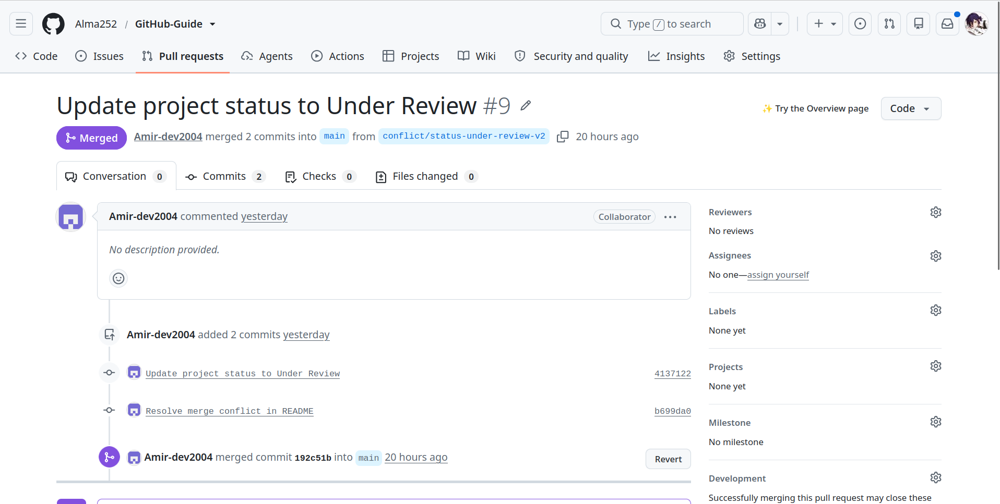
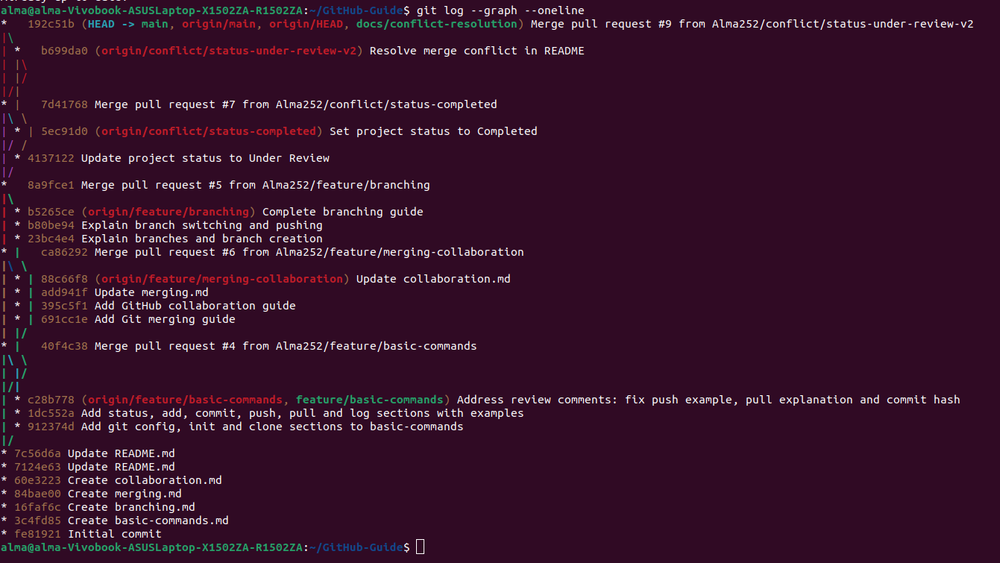

# حل Merge Conflict

## شرح سناریو
دو عضو تیم، آقای صحاف پور و آقای عامری، هر دو از یک نسخه مشترک `main` یک Branch جدا ساختند و
یک خط یکسان از `README.md` را به دو شکل متفاوت تغییر دادند.

خط اولیه:

```text
## Project Status: In Progress
```

| توسعه‌دهنده | Branch | تغییر |
|-------------|--------|-------|
| صحاف پور    | `conflict/status-completed` | `Project Status: Completed` |
| عامری       | `conflict/status-under-review-v2` | `Project Status: Under Review` |

> توضیح: عامری ابتدا Branch `conflict/status-under-review` را ساخت، اما چون
> بعد از Merge شدن PR صحاف پور از `main` جدید ساخته شده بود، Conflict رخ نداد.
> بنابراین Branch `conflict/status-under-review-v2` را از Commit قبل از Merge علی
> ساخت و Conflict واقعی از همین Branch به‌دست آمد.

## مرحله ۱: تغییرات و Merge اول
هر دو توسعه‌دهنده تغییرات خود را Commit و Push کردند و Pull Request ساختند.
Pull Request صحاف پور ابتدا Merge شد (بدون Conflict).

## مرحله ۲: بروز Conflict
بعد از Merge شدن PR صحاف پور، Pull Request عامری با پیام
**This branch has conflicts that must be resolved** مواجه شد، چون هر دو
یک خط را تغییر داده بودند.


## مرحله ۳: فایل دارای Conflict
Git علامت‌های Conflict را داخل فایل README قرار داد:


معنی علامت‌ها:

- `<<<<<<<` : شروع بخش اول (تغییر یک طرف)
- `=======` : جداکننده دو تغییر
- `>>>>>>>` : پایان بخش دوم (تغییر طرف دیگر)

## مرحله ۴: حل دستی Conflict
عامری فایل را باز کرد، علامت‌ها را حذف کرد و متن نهایی را انتخاب کرد.
سپس تغییرات را Commit و Push کرد.


## مرحله ۵: تکمیل Merge
بعد از حل Conflict، پیام Conflict از PR برطرف شد و Pull Request Merge شد.



## تاریخچه Commitها
هر دو تغییر اولیه (`Completed` و `Under Review`) در تاریخچه Repository قابل مشاهده هستند:



## نتیجه‌گیری
Merge Conflict زمانی رخ می‌دهد که دو نفر یک خط را متفاوت تغییر دهند و Git نتواند
خودکار یکی را انتخاب کند. با باز کردن فایل، حذف علامت‌ها و انتخاب متن نهایی،
Conflict حل می‌شود.